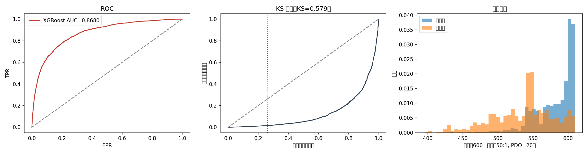
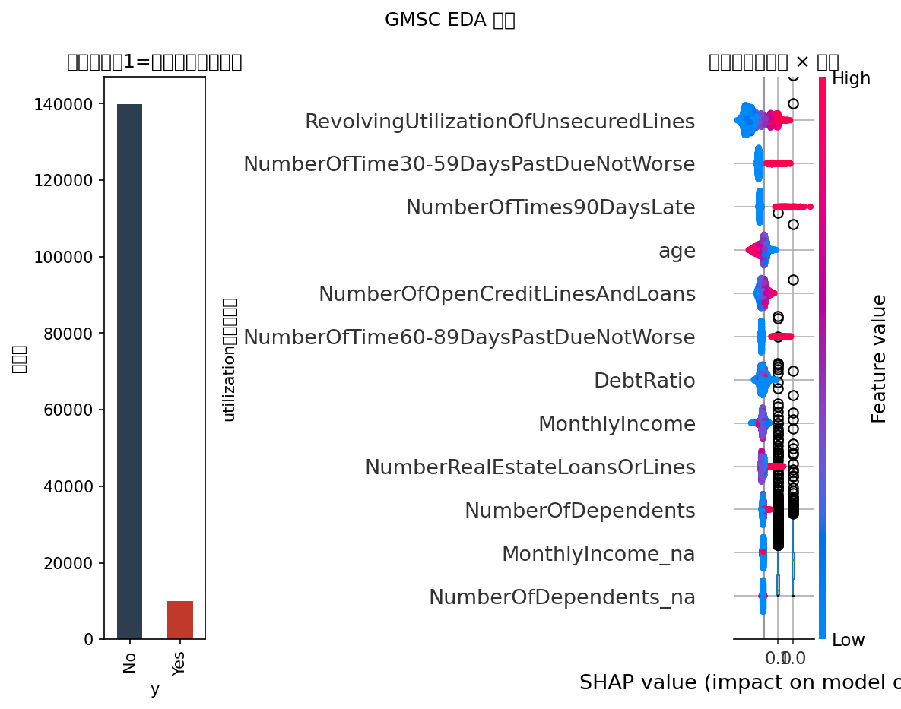
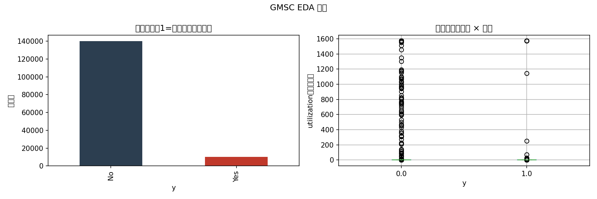
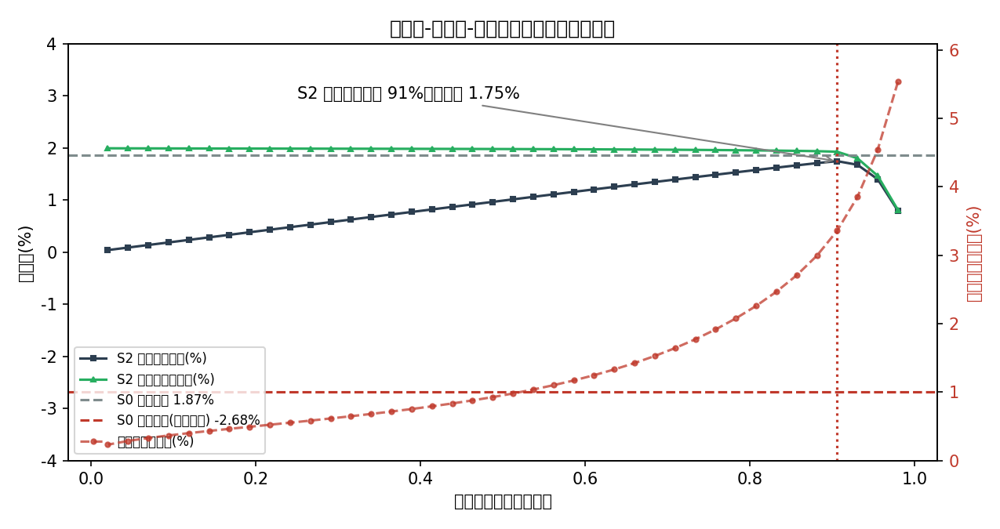

# 信用风险评分卡 × 风险-定价联动（Give Me Some Credit）

> **一句话结论**：XGBoost challenger CV AUC **0.863±0.004**（KS 0.58、Gini 0.74，全线超过 AUC≥0.78 / KS≥0.35 / Gini≥0.56 验收线）；把 PD 翻译成利率后，"评分+风险定价"策略在测试集 ¥3.75 亿账本上实现全组合年化利润率 **+1.75%**，而"无模型统一定价"因逆向选择实际成交客群坏账率 20.1%、利润率 **−2.69%**——**风险定价的年化增量利润约 ¥1,663 万**。

## 1. 业务背景与问题定义

消费信贷的两个核心问题：**谁可能违约**（风控）与**因此怎么定价**（FP&A）。本项目把两者打通：

```
PD 评分（WOE 评分卡 + XGBoost challenger）→ 分数刻度（600 分=好坏比 50:1，PDO=20）
→ 盈亏平衡利率 r*=(PD×LGD+funding+opex)/(1-PD) → 风险分档定价
→ 通过率-坏账率-利润曲线 → 三策略对比与财务影响
```

## 2. 数据说明

| 项 | 内容 |
|---|---|
| 数据集 | Give Me Some Credit（Kaggle，经 OpenML/TabArena 清洗版），**150,000 行 × 11 列** |
| 目标 | 未来两年财务困境（`SeriousDlqin2yrs`），违约率 **6.68%** |
| 数据质量 | `MonthlyIncome` 缺失 19.8%、`NumberOfDependents` 缺失 2.6%；`RevolvingUtilization`/`DebtRatio` 有极端值（>1 或上千），按 99.9% 分位截尾 |
| 口径声明 | 评分卡分箱/WOE 在训练集估计；WOE 分箱中缺失值并入最低箱（缺失与更高违约率同向，方向保守），XGBoost 侧用中位数填补 + 缺失指示 |
| 数据获取 | OpenML `did=46929`（TabArena 清洗版，`givesomecredit.arff`，约 7MB），放入 `data/raw/`（已 gitignore）；原始版见 Kaggle `GiveMeSomeCredit` |

## 3. 方法论与特征筛选

1. **IV 筛选**：等频 20 箱 + PAV 单调合并（保序回归）后计算 IV，保留 **IV>0.02**；
2. **相关性**：WOE 特征矩阵 |r|>0.7 只保留 IV 高者（本例分箱后无触发）；
3. **VIF**：`diag(inv(corr))<10`（本例无触发）。

**最终入模 6 特征**：RevolvingUtilization（IV=1.14）、30-59 天逾期（0.49）、90 天逾期（0.48）、60-89 天逾期（0.26）、NumberOfDependents（0.03）、DebtRatio（0.02）。

> 注：`age` 与违约率呈 U 型关系，被 PAV 单调约束合并为单箱（IV=0）——**单调性要求会牺牲 U 型信号**，这是评分卡可解释性的代价；XGBoost 不受此限。

## 4. 模型结果

| 模型 | CV AUC（5折 mean±std） | Test AUC | Test Gini | Test KS |
|---|---|---|---|---|
| LR WOE 评分卡 | —（单模型） | 0.8224 | 0.6448 | 0.5039 |
| XGBoost challenger | **0.8629±0.0036** | 0.8679 | 0.7358 | 0.5826 |

验收线 AUC≥0.78 / KS≥0.35 / Gini≥0.56 **全部通过**（XGBoost）。评分刻度：基准 600 分=好坏比 50:1、PDO=20，训练集分数范围 [392, 610]，均值 579。


*图 1：LR 评分卡 vs XGBoost challenger 的 ROC 与 KS 曲线——XGBoost 在左尾（低误报率区间）优势明显，KS 0.58 达消费信贷可用水平。*


*图 2：SHAP 值全局重要性——RevolvingUtilization（额度利用率）与 30-59 天逾期贡献最大，与 IV 筛选结论一致，验证模型可解释性。*


*图 3：目标分布与关键变量十分位违约率——额度利用率呈单调上升，30-59 天逾期呈阶跃式跳升。*

**PSI 监控**（训练 vs 测试）：评分分布 PSI=**0.0002**（稳定），全部特征 PSI<0.001——分层随机切分下无分布漂移，属预期；生产环境应按月监控，>0.25 触发重训评审。

## 5. 财务影响层（公式 → 假设 → 结果 → 决策）

### 5.1 公式

| 步骤 | 公式 |
|---|---|
| 盈亏平衡利率 | `r* = (PD×LGD + funding + opex) / (1 - PD)` |
| 风险定价 | `r_i = min(24%, r*_i + 2%)` |
| 单客户年损益 | `profit_i = (1-PD_i)×r_i×EAD − PD_i×LGD×EAD − (funding+opex)×EAD` |
| 客户愿付（逆向选择模型） | `wtp_i = r*_i + 3%`（竞争性溢价假设）；统一定价下只有 `wtp_i ≥ 挂牌价` 的客户成交 |

### 5.2 关键假设（可配置参数）

| 参数 | 取值 | 依据 |
|---|---|---|
| **EAD**（单户敞口） | **¥10,000** | 消费信贷单笔均值假设 |
| **LGD**（违约损失率） | **75%** | Basel III 零售无担保暴露常见区间 70%-90% 的中值（敏感性见 5.4） |
| **资金成本** | 3% | 批发融资利率假设 |
| 运营成本率 | 2% | 获客+服务分摊 |
| 目标利润率 | 2% | 定价加成 |
| **利率上限** | **24%** | 合规红线（司法保护上限） |
| 客户愿付溢价 | 3% | 竞争性定价的市场校准值（敏感性见 5.4） |

### 5.3 结果

**三策略对比**（测试集 7,500 申请、¥3.75 亿账本、挂牌利率 12.78%）：

| 策略 | 成交率 | 成交客群坏账率 | 全组合年化利润率 |
|---|---|---|---|
| S0 无模型（理论：全量成交） | 100% | 6.74% | +1.87% |
| S0 无模型（**实现：逆向选择**） | 27.3% | **20.06%** | **−2.69%** |
| S1 仅评分筛选 + 统一定价 | 17.9% | 9.98% | −0.18% |
| **S2 评分 + 风险定价联动** | 90.6% | 3.36% | **+1.75%** |

> **风险定价 +1.75% vs 统一定价 −2.69%**，年化增量利润约 **¥1,663 万**（¥3.75 亿账本）。


*图 4：通过率-坏账率-利润率联合曲线——随着通过率放宽，坏账率加速上升而利润率在score=529 处见顶，该点即 S2 最优阈值。*

### 5.4 决策建议

- **S2 vs S0（实现口径）增量 +4.43pp ≈ ¥1,663 万/年**；S2 最优阈值 score=529（通过率 90.6%），把 24% 上限下不可定价的高 PD 尾部挡在门外；
- **利率结构**：S2 批准客群平均利率 9.92%（低于挂牌 12.78%），84% 的客户获得低于挂牌价的利率——低风险客户不被高价挤出，这是竞争市场中份额与利润兼得的关键；
- **理论口径的诚实结论**：若不考虑需求响应，统一定价与风险定价的期望利润率基本持平（1.87% vs 1.75%）——**定价模式的利润优势不来自公式本身，而来自它对客群结构的塑造**（消除逆向选择 + 拦截不可定价尾部）。

**愿付溢价敏感性**（客户愿付 = r\* + 溢价，其余假设不变；复刻脚本 `src/analysis.py`，基线精确还原上表）：

| 愿付溢价 | S0实现成交率 | S0实现坏账率 | S0实现利润率 | S2利润率 | S2成交率 | S2 − S0 |
|---|---|---|---|---|---|---|
| 0%（无溢价） | 18.7% | 26.0% | −2.82% | 0.00% | 0.0% | +2.82pp † |
| 3%（基准） | 27.3% | 20.1% | −2.69% | +1.75% | 90.6% | +4.43pp |
| 5% | 38.0% | 15.7% | −2.27% | +1.75% | 90.6% | +4.01pp |

† S2 无成交（客户不接受高于自身保本的利率），该增量仅为"不亏"与"亏 2.82%"之差。

**LGD 依据**：LGD=75% 取 Basel III 零售无担保暴露常见区间（70%-90%）的中值；实际值需用组合回收数据校准。LGD 敏感性（愿付溢价 3% 不变）：

| LGD | S2 全组合利润率 | S0 实现利润率 |
|---|---|---|
| 60% | +1.76% | −2.07% |
| 75%（基准） | +1.75% | −2.69% |
| 90% | +1.71% | −3.29% |

**结论**：
- **愿付溢价是风险定价的前提，不是锦上添花**：0% 溢价时无人接受高于保本的利率，S2 成交率归零；溢价升至 5% 时统一定价的逆向选择减弱（成交率 27%→38%、坏账率 20%→16%），S2 优势反而收窄（+4.43pp → +4.01pp）——溢价→∞ 时 S0 趋近理论口径，与 S2 期望利润趋同（Jensen 恒等）。溢价假设越强，"统一定价很危险"的故事越成立；
- **S2 对 LGD 假设几乎不敏感**（60%-90% 全区间仅 ±0.05pp）——个体定价把 LGD 内生吸收进利率；而统一定价利润率随 LGD 摆动 1.2pp。**风险定价把 LGD 风险转移进价格，统一定价把 LGD 留在利润表上**——这是向 CFO 解释"为什么要改定价模式"的最短路径。

## 6. 业务建议（可落地）

1. **把评分接进定价引擎**：分数段 → PD → 建议利率对照表（见 `outputs/scorecard.csv` 分值表），实现"高风险高定价"而非一刀切拒贷；
2. **筛选与定价必须联动**：S1 证明仅做评分筛选而维持统一定价会清空客群（成交率 17.9%）——二者是同一策略的两面；
3. **监控三件套**：评分 PSI、特征 PSI、分档坏账率（ realized vs predicted）入库按月跑，PSI>0.25 或坏账率偏离预测 20% 触发重训；
4. **逾期特征治理**：三组逾期天数高度共线（原始特征 VIF 爆表），生产上建议只保留 30-59 天组并做时间衰减加权。

## 7. 如何运行

```bash
pip install -r requirements.txt
jupyter nbconvert --to notebook --execute --inplace notebooks/credit_risk_pricing.ipynb
python3 src/analysis.py   # 愿付溢价 / LGD 敏感性（基线断言校验）
```

- Notebook 代码 200 行（≤200 行约束）；固定随机种子 42；一键复跑；
- 产物：`images/`（`eda`、`roc_ks_score`、`strategy_curve`、`shap_summary` 共 4 图）、`outputs/`（`scorecard.csv` 分值表、`metrics.json` 指标、`psi_features.csv` / `psi_score_deciles.csv` 稳定性、`policy_curve.csv`、`strategy_comparison.csv`、`test_pd.csv`、`wtp_premium_sensitivity.csv` / `lgd_sensitivity.csv` 敏感性）；
- 文档：`docs/BRD.md`（业务需求）、`docs/metrics.md`（指标字典）、`docs/monitoring.md`（监控方案）；生产取数：`sql/extract.sql`（建模宽表）、`sql/metrics.sql`（经营指标口径）。

**验收标准**：`python3 src/analysis.py` 退出码为 0（全部基线断言通过）即代表利润曲线与敏感性口径复现一致——LGD=75% 基准下 S2 利润率 **+1.75%**、S0 实现利润率约 **−2.7%**；Notebook 重跑后 `outputs/metrics.json` 中 XGBoost `test_ks≈0.579`、`cv_auc≈0.863` 即为同一口径。

## 8. 局限性与声明

- GMSC 为 2011 年静态样本，无时间戳，无法做严格 OOT 验证；PSI 结论仅对分层切分有效；
- LGD/资金成本/愿付溢价均为行业假设值，上线前需用组合实际数据校准；
- 评分卡对 U 型关系（age）不敏感，重要决策建议 LR 与 XGBoost 双轨校验；
- **本项目为分析工作底稿，不构成投资建议；全部数字需具备资质的专业人士复核签署后方可使用。**
