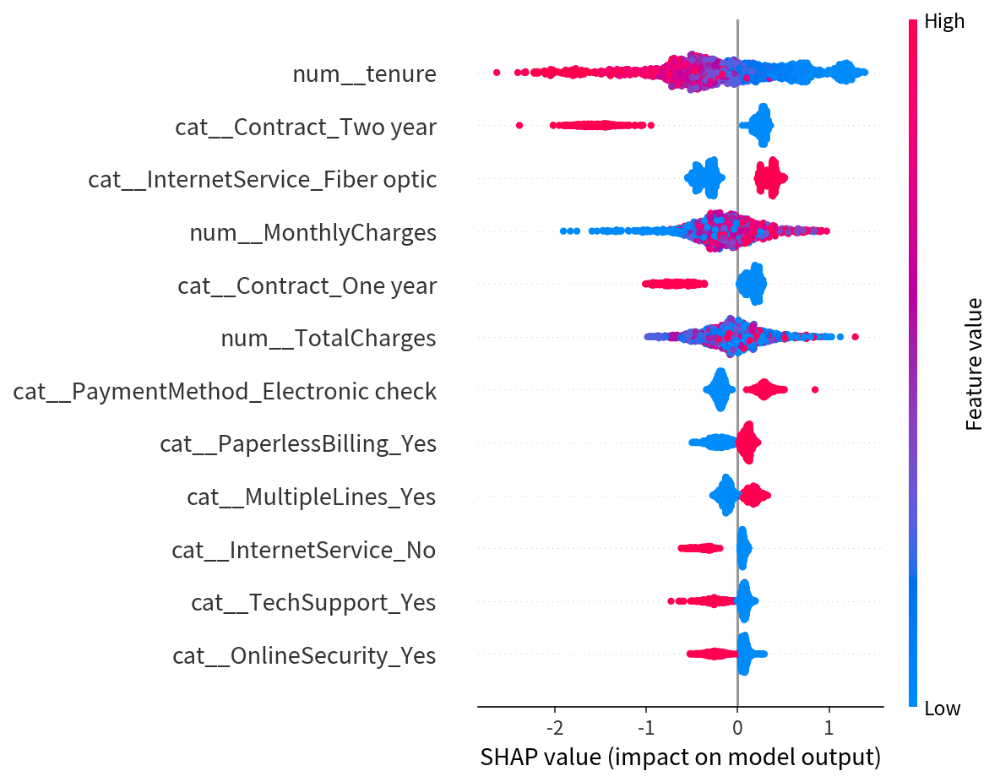
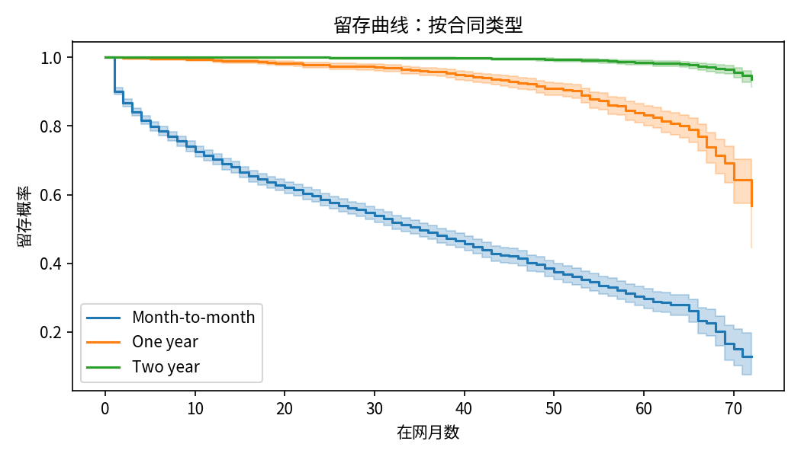
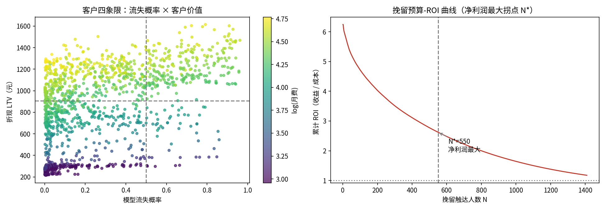

# 电信客户流失预测 × 留存经济性（Telco Customer Churn）

> **一句话结论**：XGBoost/LR 在 Telco 数据集上 AUC≈0.84、KS≈0.52，对测试集 1,409 名客户按"期望保住收益"排序触达，**净利润最大规模 N\*=550 人（预算 ¥38,500，净收益 ¥62,468，ROI 2.62）**；月约（Month-to-month）客户与前 12 个月在网客户是留存干预的优先战场。

## 1. 业务背景与问题定义

电信行业月流失率普遍在 2-3%，获客成本（CAC）高企使得**留存的经济性优于拉新**。本项目回答两个问题：

1. **风险识别**：哪些客户可能流失？（评分与分层）
2. **财务决策**：对谁挽留、触达多少人、花多少预算、赚回多少？（ROI 与预算分配）

## 2. 数据说明

| 项 | 内容 |
|---|---|
| 数据集 | IBM Telco Customer Churn（公开样本，7,043 名客户 × 21 字段） |
| 流失定义 | `Churn=Yes`（观察期末合同状态为离网），整体流失率 **26.54%** |
| 数据质量 | `TotalCharges` 11 条空值均为在网 0 个月新客户，按 0 处理；无缺失其他字段 |
| 口径偏差 | 数据集为**观察期末快照，无事件时间戳**：主切分为分层随机 80/20；按在网月数分 cohort（0-12/13-36/37-72）报告 AUC/KS 作为**时序稳定性代理**。生产环境应按事件时间戳滚动切分（见 `docs/BRD.md`） |
| 数据获取 | IBM 公开样本 `Telco-Customer-Churn.csv`（约 1MB，Kaggle `blastchar/telco-customer-churn` 同源），放入 `data/raw/`（已 gitignore） |

## 3. 方法论

```
数据清洗 → 分层切分(seed=42) → One-Hot + 标准化
   ├─ RFM 代理分群（KMeans k=4）→ 群像：流失率 × ARPU × LTV
   ├─ Cox PH（时长=tenure，事件=Churn）→ 风险比 + PH 假设检验
   ├- 分类模型：Logistic Regression vs XGBoost challenger → AUC/KS/PR-AUC + cohort 稳定性
   ├─ SHAP（TreeSHAP）→ 全局驱动因子
   └─ 财务影响层：KM→折现 LTV → RaR → 挽留 ROI 曲线 → 优先挽留名单
```

- **RFM 代理构造**（电信无交易流水）：F=增值服务订阅数、M=月费（ARPU）、R=在网月数（生命周期阶段代理）；
- **防泄漏**：预处理（One-Hot/标准化）仅在训练集拟合；KMeans 仅用于客户画像，不参与训练特征。

## 4. 模型结果

| 模型 | AUC | KS | PR-AUC |
|---|---|---|---|
| Logistic Regression | **0.842** | 0.521 | 0.635 |
| XGBoost（challenger） | 0.835 | **0.524** | 0.642 |

**时序稳定性（XGBoost，按 tenure cohort）**：0-12 个月 AUC 0.763 / 13-36 个月 0.798 / 37-72 个月 0.782——各生命周期阶段排序力稳定（>0.75 验收线）。

> **为什么按 cohort 报告而不是单一 AUC**：Telco 是观察期末快照、无事件时间戳，直接分层随机切分会让"未来客户"泄漏进训练集。按在网月数分 cohort 报告 AUC，是在没有时间戳的前提下，**对时序稳定性做的最接近的代理检验**——三个 cohort 的 AUC 都能守住 0.75，说明模型不依赖单一生命周期阶段的特征分布。

**Cox PH 要点**：tenure 风险比 0.37/SD（在网越久流失风险越低）、Two year 合同 0.41、One year 0.57（vs Month-to-month）、Fiber optic 1.54、Electronic check 1.41。注意：Schoenfeld 检验显示 Contract 等多个变量**违背 PH 假设**（效应随时长变化），故 Cox 仅作方向性经济解释，运营口径以分类模型为准。

> **PH 假设违背意味着什么**：比例风险假设要求协变量效应不随时间变化。Contract 违背该假设，说明"年约的保护作用"在客户生命周期早期最强、后期衰减——这恰恰指向一条运营结论：**年约转化要在客户生命早期推进**（见第 6 节第 2 条），而不是等客户成熟后再谈。Cox 在这里的价值不是提供精确系数，而是**暴露了一个时间维度的结构性信号**。

**分群画像**：Cluster 0（n=2,315，流失率 47.5%，ARPU ¥77.6，LTV ¥1,109）为"高概率 × 高价值"核心战场，贡献 LTV 池 51%。


*图 1：SHAP 值全局驱动因子——合同类型（Contract）、在网时长（tenure）、付费方式（Electronic check）是流失的三大驱动，与 Cox PH 风险比结论互相印证。*


*图 2：Kaplan-Meier 生存曲线按合同类型分层——Month-to-month 客户留存曲线最陡，是留存干预第一战场。*

## 5. 财务影响层（公式 → 假设 → 结果 → 决策）

| 步骤 | 公式 | 关键假设 | 结果（测试集 1,409 人） |
|---|---|---|---|
| 折现期望 LTV | `LTV = Σ_{m=1..36} MonthlyCharges × 60% × S(tenure+m) / (1+r)^m` | 毛利率 60%、年折现率 10%、S 为 KM 生存函数、horizon 36 个月 | 人均 LTV ≈ ¥787 |
| 收入风险敞口 RaR | `RaR = Σ MonthlyCharges × p × 12` | 12 个月窗口、未折现 | **¥330,995，占测试集年化收入 30.55%** |
| 挽留 ROI | 按 `p × 30% × LTV` 降序触达；收益 `= p × 30% × LTV`，单客成本 = 触达 ¥20 + 权益 ¥50 | 干预使流失概率**相对**下降 30% | 见下 |

> **为什么用折现 LTV 而不是 ARPU×12**：挽留决策要比较"现在花 ¥70 触达成本"和"未来 36 个月保住的一串期望毛利"，两者必须同口径。LTV 用 KM 生存函数按客户自己的 tenure 推出剩余留存概率，再逐月折现——**这是把"客户值多少钱"从静态快照变成期望现值的关键一步**。用 ARPU×12 会把 12 年长约客户和月约客户估成同一价值，从而错误排序触达优先级。

**决策规则**：ROI 曲线按收益排序后必然递减，"ROI 峰值"恒为 N=1 无决策意义；取**累计净利润最大**的 N\*（边际收益=边际成本 ¥70 的拐点）：

| 方案 | 触达人数 | 预算 | 净收益 | ROI |
|---|---|---|---|---|
| **净利润最大 N\*** | 550 人（39% 客户） | ¥38,500 | **¥62,468** | 2.62 |
| 保守预算方案 | 200 人（14% 客户） | ¥14,000 | ¥42,413 | **4.03** |

**决策建议**：若预算受限，先做 Top-200（ROI 4.03，覆盖最高期望收益客群）；预算充足时扩至 550 人；超过 N\* 后边际客户收益低于 ¥70 触达成本，不应继续扩面。


*图 3：按期望收益降序触达的累计净收益曲线——净收益在 N\*=550 人处见顶（边际收益=边际成本 ¥70），其后开始下降；Top-200 区间 ROI 最高（4.03）。*

**挽留成功率敏感性**（uplift=干预使流失概率相对下降的比例，其余假设不变；复刻脚本 `src/analysis.py`，基线精确还原上表）：

| 挽留成功率 | 最优触达 N\* | 触达预算 | 净收益 | 毛 ROI | 决策含义 |
|---|---|---|---|---|---|
| 10% | 182 人 | ¥12,740 | ¥4,835 | 1.38 | 勉强打平，只值得小规模试点 |
| 20% | 436 人 | ¥30,520 | ¥30,241 | 1.99 | 保守预算方案 |
| **30%（基准）** | **550 人** | **¥38,500** | **¥62,468** | **2.62** | 当前建议 |
| 40% | 622 人 | ¥43,540 | ¥96,925 | 3.23 | 可扩至全量高风险客群 |

**结论**：挽留成功率是 ROI 的**最大杠杆**——每下降 10pp，N\* 收缩加速（−72 / −114 / −254 人），净收益约损失 ¥2.5-3.4 万；降至 10% 时项目基本失去经济性。uplift=30% 是行业经验假设，**上线后必须先做 A/B 实验校准该假设，再决定预算规模**——这也是本表存在的意义：让"拍脑袋的 30%"变成"可证伪的 30%"。

## 6. 业务建议（可落地）

1. **合同结构是第一杠杆**：Month-to-month 客户留存曲线最陡、Cox 风险比最高（Two year HR=0.41）。推"年约转化 + 续约折扣"比泛发优惠券更根本，建议对 Cluster 0 中的月约客户做定向年约报价。
2. **前 12 个月是生死线**：tenure 0-12 cohort 流失率显著更高（Cluster 0 平均 tenure 短、ARPU 高）。新手期 90 天内介入的期望收益最高，应把 onboarding 干预前置。
3. **支付方式暗流**：Electronic check 风险比 1.41——改用自动扣费可同时降低流失与坏账，属"零边际成本"运营动作。
4. **名单落地**：`outputs/priority_retention_list.csv` 输出 Top-200 优先挽留客户（含 churn_prob、LTV、expected_save），可直接交客服团队执行；上线后以 A/B 实验校准 uplift=30% 假设。

## 7. 如何运行

```bash
pip install -r requirements.txt
jupyter nbconvert --to notebook --execute --inplace notebooks/churn_economics.ipynb
python3 src/analysis.py   # 挽留成功率敏感性（基线断言校验）
```

- Notebook 代码 134 行（≤200 行约束）；固定随机种子 42；一键复跑；
- 产物：`images/`（`km_by_contract`、`shap_summary`、`retention_economics` 共 3 图）、`outputs/`（`cluster_profile.csv` 分群画像、`metrics.json` 指标、`priority_retention_list.csv` 优先名单、`test_scored.csv` 测试集评分、`uplift_sensitivity.csv` 挽留成功率敏感性）；
- 文档：`docs/BRD.md`（业务需求）、`docs/metrics.md`（指标字典）、`docs/monitoring.md`（监控与 A/B 方案）；生产取数：`sql/extract.sql`（建模宽表）、`sql/metrics.sql`（经营指标口径）。

**验收标准**：`python3 src/analysis.py` 退出码为 0（全部基线断言通过）即代表挽留经济性口径复现一致——挽留成功率 30% 基准下最优触达 **N\*=550 人**、净收益 **¥6.2 万**、**ROI 2.62**。

## 8. 局限性与声明

- Telco 为横截面快照，KM/LTV 估计受长度偏差影响，LTV 为期望口径而非会计口径；
- PH 假设部分违背，Cox 风险比为时间平均效应；
- uplift/触达成本/权益成本为行业经验假设，需 A/B 实验校准；
- **本项目为分析工作底稿，不构成投资建议；全部数字需具备资质的专业人士复核签署后方可使用。**
