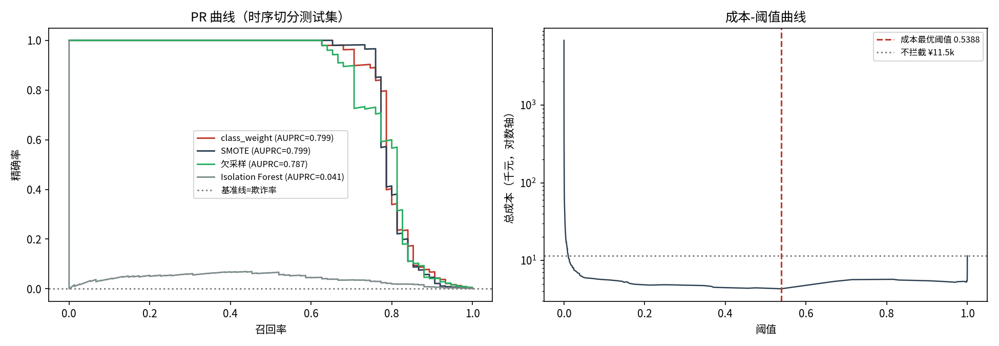
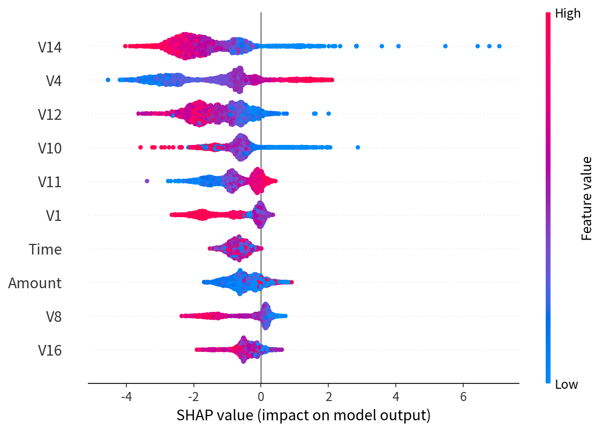
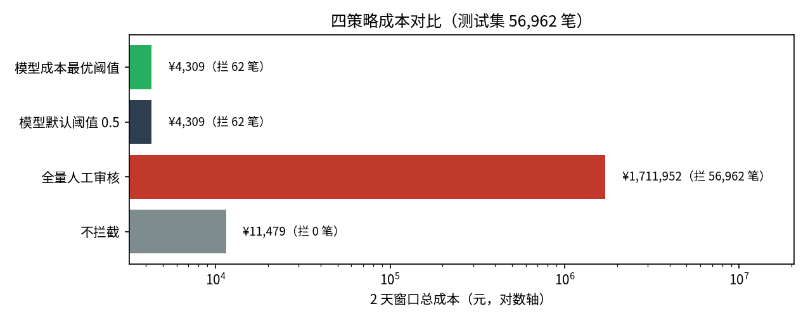
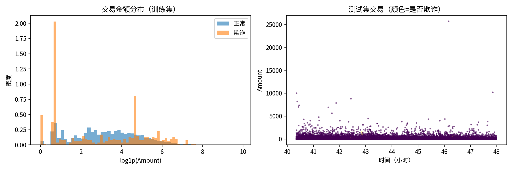

# 交易欺诈检测 × 成本-收益阈值优化（Credit Card Fraud Detection）

> **一句话结论**：class_weight 方案 AUC 0.989 / AUPRC 0.799（时序切分，随机切分会虚高到 0.876）；按成本矩阵（误杀 ¥120 vs 漏判=金额+¥50）精确标定阈值 **0.5388**——只拦截 0.11% 交易即抓住 74.7% 欺诈，**2 天窗口总成本 ¥4,309，比不拦截省 62.5%（¥7,170），比全量人工审核省 99.7%**；V14/V4/V12 组合规则精确率 23.3%（欺诈基准的 177 倍），可直接进规则引擎。

## 1. 业务背景与问题定义

欺诈率仅 0.172% 的场景下，**AUC 高不等于赚钱**：每一笔误杀有成本（人工审核 + 客户体验），每一笔漏判有损失（欺诈金额 + 调查费用）。本项目把模型输出翻译成经营决策：

1. **识别**：三法（class_weight / SMOTE / 欠采样）哪值得上线？无监督基线差多少？
2. **评估**：为什么随机切分是错的（同批次欺诈泄漏，AUPRC 虚高 9.6%）？
3. **决策**：阈值定在哪里，取决于**成本矩阵**而不是 F1——本数据集最优阈值 0.54，远高于常规 0.5 以下直觉，原因见财务影响层。

## 2. 数据说明

| 项 | 内容 |
|---|---|
| 数据集 | Credit Card Fraud Detection（Kaggle 公开版，284,807 笔 × 30 字段） |
| 标签 | `Class=1` 为欺诈，共 492 笔，**占比 0.172%** |
| 时间 | `Time` = 交易发生秒数（跨度约 48 小时，2013 年欧洲持卡人） |
| 特征 | `V1-V28` 为 PCA 脱敏特征 + `Amount` + `Time` |
| 关键分布 | **欺诈金额集中于极小值**（大量 ¥1 交易，测试集欺诈均值仅 ¥103）——直接决定成本结构与最优阈值 |
| 切分 | **时序切分**：前 80% 时间训练（227,845 笔 / 417 欺诈），后 20% 测试（56,962 笔 / 75 欺诈） |

## 3. 方法论

```
数据加载 → 时序切分（禁随机切分）
   ├─ EDA：金额分布 / 时间-金额散点
   ├─ 类别不平衡三法对比（XGBoost 300 棵）：class_weight vs SMOTE vs 欠采样 → AUPRC
   ├─ 基线对照：Isolation Forest（无监督）+ 随机切分 vs 时序切分（泄漏演示）
   ├─ 成本敏感阈值：argmin 总成本（分段常数函数精确求解，非网格）
   ├─ SHAP：全局因子 → Top3 特征组合成可解释拦截规则
   └─ 监控四指标 + 财务影响层
```

- **防泄漏**：重采样仅在训练集进行；评估只用时序切分；
- **阈值精确求解**：总成本关于阈值分段常数，按概率降序累加成本增量 O(n log n) 求全局最优——本项目实测：80-99.9 分位网格会整段跳过低金额欺诈场景的真正最优点（0.5 附近）。

## 4. 模型结果

**类别不平衡三法**（同一 XGBoost，300 棵，时序切分测试集）：

| 方法 | AUC | AUPRC | 训练样本数 | 结论 |
|---|---|---|---|---|
| **class_weight** | **0.9891** | **0.7993** | 227,845 | 冠军，工程成本最低 |
| SMOTE | 0.9772 | 0.7987 | 454,856 | 34 万合成样本只换来持平精度 |
| 欠采样 | 0.9895 | 0.7868 | 834 | 丢掉 99.8% 多数类信息，AUPRC 最差 |

**基线对照**：Isolation Forest AUC 0.9467 / AUPRC 0.0413——无监督在 0.17% 欺诈率下精确率接近失效，仅作兜底。


*图 1：精确率-召回率曲线（AUPRC 0.7993）——在 0.172% 的极端不平衡下，PR 曲线比 ROC 更能反映实际拦截质量。*

**切分方式的影响**（同一个 class_weight 模型）：

| 切分 | AUPRC | 说明 |
|---|---|---|
| 随机切分（错误做法） | 0.8764 | 同批次欺诈同时进训练/测试，**泄漏性虚高 +9.6%** |
| 时序切分（本口径） | 0.7993 | 上线评估的唯一正确口径 |


*图 2：SHAP 值全局因子——V14 / V4 / V12 贡献最大，即业务建议中组合拦截规则的三特征来源。*

## 5. 财务影响层（公式 → 假设 → 结果 → 决策）

**成本矩阵**（可配置假设，财务部季度校准）：

| 错误类型 | 成本 | 构成 |
|---|---|---|
| 误杀（好交易被拦截） | **¥120/笔** | 人工审核 ¥30 + 客户体验/流失 ¥90 |
| 漏判（欺诈放行） | **欺诈金额全额 + ¥50/笔** | 资金损失 + 运营调查 |

**误杀成本 ¥120 的估算依据**（经验假设，财务部季度校准）：

| 构成 | 金额 | 估算口径 |
|---|---|---|
| 人工审核 | ¥30/笔 | 客服复核 5 分钟 × ¥6/分钟（坐席工时 + 系统分摊） |
| 客户体验/流失 | ¥90/笔 | 误杀致客户流失概率 +1% × LTV ¥9,000 |
| 合计 | **¥120/笔** | — |

LTV 口径：持卡人年均消费 ¥15 万 × 综合商户费率 0.6% × 留存年限 10 年 ≈ ¥9,000——**误杀拦掉的不是一笔交易，而是一条持卡关系的期望终身价值**，这是误杀成本远超"审核工时"的原因。

**总成本公式**：`C(θ) = FP(θ)×120 + Σ_{漏判} (Amount + 50)`，最优阈值 `θ* = argmin C(θ)`。

**结果**（测试窗口 2 天，56,962 笔）：

| 策略 | 拦截笔数 | 召回 | 总成本 | vs 不拦截 |
|---|---|---|---|---|
| 不拦截 | 0 | 0% | ¥11,479 | — |
| 全量人工审核 | 56,962 | 60% | ¥1,711,952 | +14,795% |
| 模型默认阈值 0.5 | 62 | 74.7% | ¥4,309 | -62.5% |
| **模型成本最优阈值 0.5388** | **62（0.109%）** | **74.7%** | **¥4,309** | **-62.5%** |

**为什么最优阈值高达 0.54**：测试集欺诈均值仅 ¥103，漏判一笔期望成本 ≈ ¥153，而误杀一笔固定 ¥120——只有当 `P(欺诈) × E[损失] > 120` 才值得拦截。**同一模型，成本结构决定阈值**：

| 误杀成本假设 | 最优阈值 | 召回 | 总成本 |
|---|---|---|---|
| ¥50（体验损失小） | 0.4568 | 76.0% | ¥3,888 |
| ¥120（基准） | 0.5388 | 74.7% | ¥4,309 |
| ¥300（误杀客诉严重） | 0.9986 | 62.7% | ¥5,329 |

> 注：默认阈值 0.5 与成本最优阈值给出同一拦截集是巧合（0.5-0.54 之间无预测概率值）——换一组成本假设，两者立刻分叉，**阈值必须由成本矩阵标定，不能拍脑袋**。


*图 3：总成本随阈值变化曲线——成本函数为分段常数，最优阈值 0.5388 处取得最小值 ¥4,309（网格搜索会漏掉此点）。*


*图 4：交易金额分布与时间-金额散点——欺诈金额集中于极小值（大量 ¥1 交易），这是最优阈值高达 0.54 的直接原因。*

**决策建议**：
- 模型拦截 vs 不拦截，2 天节省 **¥7,170（-62.5%）**；按此量与结构外推**年化约 ¥131 万**（仅数量级参考，上线后以实际成本重算）；
- 相对全量人工审核（¥171.2 万/2 天）节省 99.7%——模型的价值不仅是抓欺诈，更是**把人工审核从全量变成 62 笔的复核队列**；
- 每千笔交易期望成本 **¥75.7**，作为日常经营记分卡。

## 6. 业务建议（可落地）

1. **上线用 class_weight**：三法 AUPRC 持平（0.786-0.799），SMOTE 把训练集吹到 45 万行、欠采样只剩 834 行，工程成本与稳定性都差——不平衡问题优先用 `scale_pos_weight`；
2. **阈值按成本矩阵定**：本例 0.5388（拦截 0.11%、召回 74.7%、精确率 90.3%）。误杀成本假设每变一档，最优阈值在 0.46-1.00 间移动，建议每季度随成本矩阵重标；
3. **规则 + 模型双通道**：V14∈(-14.27,-1.2] 且 V4∈(1.24,15.3] 且 V12∈(-9.32,-0.7] 覆盖 236 笔、精确率 23.3%（基准 177 倍）、召回 73.3%——规则做前置实时拦截（微秒级、可解释、可向客户交代），模型分做复核队列；
4. **上线后看四个数**（`outputs/monitoring_metrics.csv`）：评分 PSI（0.0014，>0.25 告警）、最优阈值精确率（0.9032，<0.15 告警）、Top-500 精确率（0.128，<0.10 告警）、每千笔期望成本（¥75.7，环比 +50% 告警）——任一越线触发重训或阈值重标。

## 7. 如何运行

```bash
pip install -r requirements.txt
jupyter nbconvert --to notebook --execute --inplace notebooks/fraud_threshold_optimization.ipynb
```

- Notebook 代码 **154 行**（≤200 行约束）；固定随机种子 42；一键复跑；
- 产物：`images/`（`eda`、`pr_curve`、`strategy_cost`、`shap_summary` 共 4 图）、`outputs/`（`model_comparison.csv` 三法对比、`strategy_cost.csv` 策略成本、`threshold_curve.csv` 阈值曲线、`threshold_sensitivity.csv` 敏感性、`fraud_rules.csv` 规则、`monitoring_metrics.csv` 监控指标共 6 表）；
- 文档：`docs/BRD.md`（业务需求）、`docs/metrics.md`（指标字典）、`docs/monitoring.md`（监控与抽检回流方案）；生产取数：`sql/extract.sql`（特征宽表）、`sql/metrics.sql`（成本与监控指标口径）；
- 数据获取：Kaggle `mlg-ulb/creditcardfraud`（`creditcard.csv`，约 144MB），放入 `data/raw/`（已 gitignore）。

## 8. 局限性与声明

- 数据集为 2013 年欧洲两天交易，PCA 特征无业务含义，规则仅作方法演示（生产应对原始特征提规则）；
- 年化外推假设欺诈率与客群结构平稳，**仅数量级参考**；成本矩阵（¥120/¥50）为经验假设，需人工抽检与 A/B 校准；
- "全量人工审核拦下 60% 欺诈"为示意假设，用于构造成本上界；
- **本项目为分析工作底稿，不构成投资建议；全部数字需具备资质的专业人士复核签署后方可使用。**
