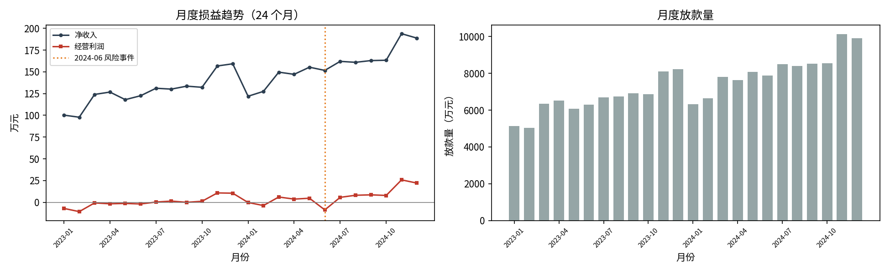
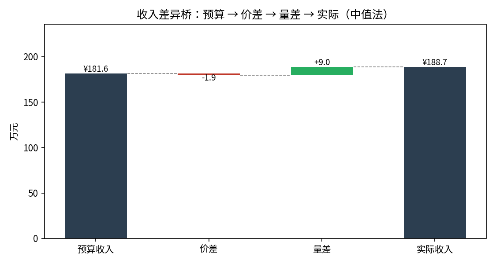
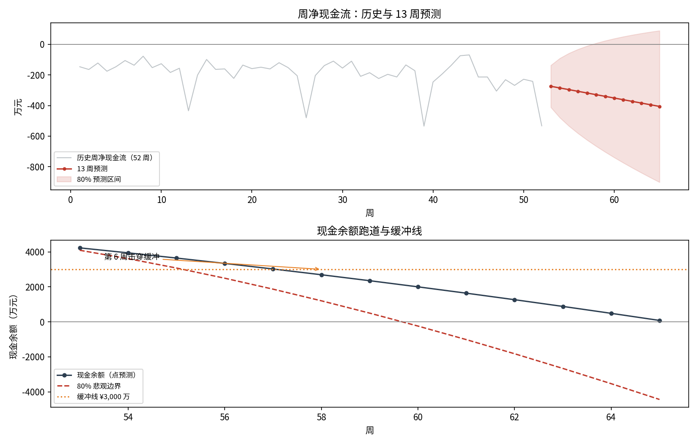
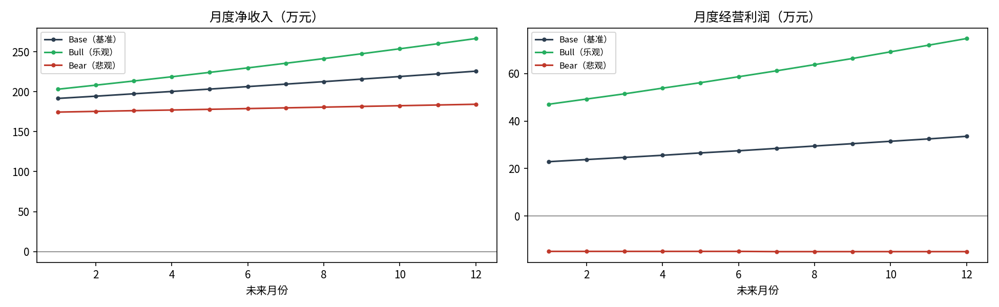

# 模拟 Fintech 月度经营分析包（预算差异 × 13 周现金流 × 三情景 × 融资建议）

> **一句话结论**：模拟消费信贷平台"星链数科"利润刚转正（−7 → +22 万/月），但放款本金净投放使现金流持续为负——13 周预测现金 **第 6 周击穿 ¥3,000 万缓冲线、第 13 周见底 ¥80 万**，融资缺口 **¥2,920 万**；建议第 4 周前首笔提取 ¥3,000 万（循环授信额度 ¥7,500 万覆盖 80% 悲观边界）。最新月收入超预算 ¥7.1 万**全部来自放量**（量差 +9.0 / 价差 −1.9）——以价换量，需盯净收入率。

## 1. 业务背景与问题定义

增长期消费信贷平台的典型困境：**损益表刚盈利，现金流量表在失血**——放款本金净投放（回收系数 0.92 < 1）使经营现金流结构性为负。月度经营分析包要回答四个问题：

1. **预算差异**：最新月收入超/差预算，是量的问题还是价的问题？（中值法量价分解）
2. **流动性**：未来 13 周现金何时见底？什么时候必须融资？（Holt 预测 + 现金跑道）
3. **盈利前瞻**：三情景下未来 12 个月盈利能力走向？（损益口径）
4. **融资决策**：融多少、什么时候到位、用什么工具？（缺口 × 时机 × 工具）

## 2. 数据说明

| 项 | 内容 |
|---|---|
| 数据性质 | **固定种子模拟**（`src/finance.simulate_company`，seed=42），非真实公司 |
| 月度损益 | 24 个月（2023-01 ~ 2024-12）：放款量、净收入率、净收入、获客、运营、信用损失、经营利润 |
| 周度现金流 | 52 周：流入（存量回收，回收系数 0.92——敏感性见第 8 节）、流出（新放款 + 获客 + 运营 + 信用损失 + 季度末营销脉冲） |
| 期初现金 | ¥4,500 万；流动性缓冲线 ¥3,000 万（约 6 周净流出） |
| 关键事件 | 2024-06 信用损失率 +0.15pp（风险事件），当月经营利润 ¥−8.7 万（前后月约 +5 万） |
| 预算口径 | 最新月预算：放款量为实际 1/1.05（实际超目标 5%）、净收入率为实际 +0.02pp（实际价更低） |

**损益趋势**：月净收入 ¥100.2 → ¥188.7 万；经营利润 ¥−7.0 → ¥22.1 万（24 个月中 9 负 14 正，2024 年转正）——**走向盈亏平衡的增长平台**。


*图 4：24 个月净收入与经营利润趋势——净收入稳步上升，经营利润在 2024 年转正，但放款本金净投放使现金流仍未同步转正。*

## 3. 方法论

```
月度损益（24 个月，含预算列）
   ├─ 模块 1：中值法量价分解 → 收入差异桥（瀑布图）
   └─ 模块 3：三情景损益前瞻（Base / Bull / Bear）
周度现金流（52 周）
   └─ 模块 2：Holt 线性指数平滑（网格搜索 α/β）→ 13 周预测 + 80% 区间 → 现金跑道
模块 4：融资缺口 = max(0, 缓冲线 − 最低现金) → 工具 × 额度 × 时点建议
```

- **中值法**（价差/量差各按两端中值加权）替代传统"先量后价"，归因不冲突、无顺序依赖，恒等式 `价差+量差=总收入差异` 在 Notebook 中断言校验；
- **80% 预测区间**：残差 σ × 1.2816 × √h（随机游走近似，区间随提前期扩大）；
- **两个口径分开报告**：流动性（含本金净投放，13 周）× 盈利（损益口径，12 个月）——FP&A 标准分工，避免用利润代替现金。

## 4. 结果一：预算差异（模块 1）

最新月 2024-12：**预算收入 ¥181.6 vs 实际收入 ¥188.7（差异 ¥+7.1）**

| 分解项 | 数值 | 解读 |
|---|---|---|
| 价差 | **¥−1.9** | 净收入率 1.91% vs 预算 1.93%（竞争性降价） |
| 量差 | **¥+9.0** | 放款 9,902 vs 预算 9,430 万（获客超预期） |
| 合计 | **¥+7.1** | 收入超预算全部由放量贡献 |

**结论**：典型"以价换量"。收入超预算不是经营效率改善，而是获客投入换来的规模——若净收入率持续下行，利润将被量差掩盖。


*图 1：最新月收入差异桥——价差 ¥−1.9 万、量差 ¥+9.0 万，合计 ¥+7.1 万，超预算全部由放量贡献。*

## 5. 结果二：13 周现金流预测（模块 2）

Holt 线性指数平滑（网格搜索得 α=0.1、β=0.25，残差 σ=107）：

| 指标 | 数值 | 说明 |
|---|---|---|
| 预测周净现金流 | ¥−274 → ¥−406 | 随规模扩大，本金净投放加深 |
| 现金跑道 | 期初 ¥4,500 → 第 13 周 **¥80** | 点预测持续下行、无自我救赎 |
| 缓冲线击穿 | **第 6 周** | 低于 ¥3,000 万缓冲线 |
| 80% 悲观边界 | 第 13 周 **¥−4,434** | 压力情形下约第 11 周现金转负 |
| 融资缺口 | **¥2,920 万** | = max(0, 3,000 − 80) |


*图 2：13 周现金流预测（含 80% 区间）——第 6 周击穿 ¥3,000 万缓冲线，第 13 周点预测见底 ¥80 万，80% 悲观边界触及 ¥−4,434 万。*

## 6. 结果三：三情景损益前瞻（模块 3）

| 情景 | 12 个月收入合计 | 经营利润合计 | 利润率 | 年末月利润 |
|---|---|---|---|---|
| Base（月增 1.5%，驱动持平） | ¥2,498 万 | **¥337 万** | 13.5% | ¥34 万 |
| Bull（月增 2.5%，NIM +5%，获客 −10%，损失 −15%） | ¥2,802 万 | ¥724 万 | 26.0% | ¥75 万 |
| Bear（月增 0.5%，NIM −8%，获客 +10%，损失 +30%） | ¥2,153 万 | **¥−179 万** | −8.3% | ¥−15 万 |

**结论**：盈利区间 ¥−179 万 ~ ¥724 万，**盈利尚不足以覆盖本金投放的现金消耗**——融资是增长的必要条件，不是可选项。


*图 3：三情景 12 个月经营利润前瞻——Base ¥337 万 / Bull ¥724 万 / Bear ¥−179 万，Bear 情形年末月利润转负。*

## 7. 结果四：融资建议（模块 4）

| 事项 | 结论 |
|---|---|
| 融资工具与额度 | **银行循环授信 ¥7,500 万**（= 80% 悲观边界缺口 ¥7,434 万向上取整）；额度未提用不计息，优于一次性股权稀释 |
| 首笔提取与时点 | **第 4 周前提取 ¥3,000 万**（点预测缺口 ¥2,920 万向上取整，缓冲击穿前 2 周安全边际） |
| 不行动的代价 | 第 13 周现金见底 → 放款资金违约 → 增长中断（获客投入沉没） |
| 备用方案 | 股东借款（快但伤资产负债表）、股权稀释（慢且贵） |

## 8. 财务影响层汇总（公式 → 假设 → 结果 → 决策）

| 模块 | 公式 | 关键假设 | 结果 | 决策 |
|---|---|---|---|---|
| 预算差异 | 价差=(P实−P预)×(Q实+Q预)/2；量差=(Q实−Q预)×(P实+P预)/2 | 两因子、无产品结构变化 | 价差 ¥−1.9、量差 ¥+9.0、合计 ¥+7.1 万 | 收入超预算全靠放量——盯净收入率，防止"以价换量"侵蚀利润 |
| 13 周现金 | 现金跑道 = 期初 + cumsum(预测周净CF)；缺口 = max(0, 缓冲−最低现金) | 缓冲线 ¥3,000 万；回收系数 0.92（敏感性见下表）；Holt α=0.1/β=0.25；80% 区间=±1.2816σ√h | 第 6 周击穿缓冲、第 13 周见底 ¥80 万；缺口 ¥2,920 万 | 第 4 周前首笔提取 ¥3,000 万 |
| 三情景 | 利润 = 放款量×(NIM−获客率−损失率) − 运营成本 | 驱动乘数（见第 6 节表） | Base ¥337 万 / Bull ¥724 万 / Bear ¥−179 万 | 盈利覆盖不了本金投放——融资是必要条件 |
| 融资建议 | 额度 = 压力情形缺口向上取整；首笔 = 点预测缺口 + 2 周安全边际 | 循环授信未提用不计息 | 授信 ¥7,500 万、首笔 ¥3,000 万 | 直接进资金计划会；不行动则第 13 周放款资金违约 |

**回收系数敏感性**（`src/analysis.py`，四情景共用种子 42，唯一差异为回收系数；口径与模块 2 一致）：

| 回收系数 | 13 周净现金流合计 | 击穿缓冲周 | 13 周最低现金 | 融资缺口 |
|---|---|---|---|---|
| 1.00（本金零净投放） | ¥−1,876 万 | 第 12 周 | ¥2,624 万 | ¥376 万 |
| 0.95 | ¥−3,465 万 | 第 7 周 | ¥1,035 万 | ¥1,965 万 |
| **0.92（基准）** | **¥−4,420 万** | **第 6 周** | **¥80 万** | **¥2,920 万** |
| 0.88 | ¥−5,691 万 | 第 4 周 | ¥−1,191 万 | ¥4,191 万 |

**结论**：

1. **回收系数是现金流失血的第一驱动，且近乎线性**：每降 1pp，13 周最低现金约降 ¥318 万、融资缺口约扩大 ¥318 万（1pp × 13 周回收存量 ≈ ¥318 万）——从 1.00 到 0.88 共 12pp，缺口从 ¥376 万扩大到 ¥4,191 万（约 11 倍）；
2. **回收系数不是唯一驱动**：即使回到 1.00（本金零净投放），运营成本 + 季度末营销脉冲仍使 13 周净流出 ¥1,876 万、第 12 周击穿缓冲线、残留 ¥376 万缺口——增长期平台的现金消耗是结构性的，回收系数只决定失血速度，**"回收率修好就自平衡"不成立**；
3. **组合压力下的额度检视**：若回收系数恶化至 0.88 且落入 80% 悲观边界（第 13 周 ¥−5,707 万），缺口将达 ¥8,707 万，超出当前 ¥7,500 万授信额度约 ¥1,200 万——额度审批应把"回收系数 −4pp"作为压力情景一并报送；
4. **监控含义**：回收系数偏离 0.92 超过 2pp（催回政策调整、客群结构变化都会移动该系数）时，13 周预测与融资建议必须重跑。

## 9. 如何运行

```bash
pip install -r requirements.txt
jupyter nbconvert --to notebook --execute --inplace notebooks/monthly_business_pack.ipynb
python3 src/analysis.py   # 回收系数敏感性（独立可跑，不依赖 Notebook 产物）
```

- Notebook 代码 **132 行**（≤200 行约束）；固定种子 42，数据完全可复现；一键复跑；
- 产物：`images/`（`monthly_trend`、`variance_bridge`、`cash_forecast`、`scenarios` 共 4 图）、`outputs/`（`monthly_pl.csv` 月度损益、`weekly_cash.csv` 周现金流、`variance_bridge.csv` 差异桥、`scenarios.csv` 情景、`cash_forecast_13w.csv` 13 周预测、`funding_advice.csv` 融资建议、`recovery_sensitivity.csv` 回收系数敏感性共 7 表）；
- 文档：`docs/BRD.md`（业务需求）、`docs/metrics.md`（指标字典）、`docs/monitoring.md`（月度滚动重估与资金监控方案）；生产取数：`sql/extract.sql`（经营宽表）、`sql/metrics.sql`（经营与流动性指标口径）。

## 10. 局限性与声明

- 数据为**模拟**（固定种子），量级参考行业经验值，不代表任何真实公司；生产环境应以实际总账/流水复算；
- Holt 为单序列方法，未纳入放款计划、催回政策等前瞻信息——生产可用驱动因子法（放款量 × 回收率）替代；
- 80% 区间为随机游走近似，未覆盖结构性断点（如监管政策突变）；
- 三情景乘数为主观假设，应由业务/风险/财务三方联审；
- **本项目为分析工作底稿，不构成投资建议；全部数字需具备资质的专业人士复核签署后方可使用。**
