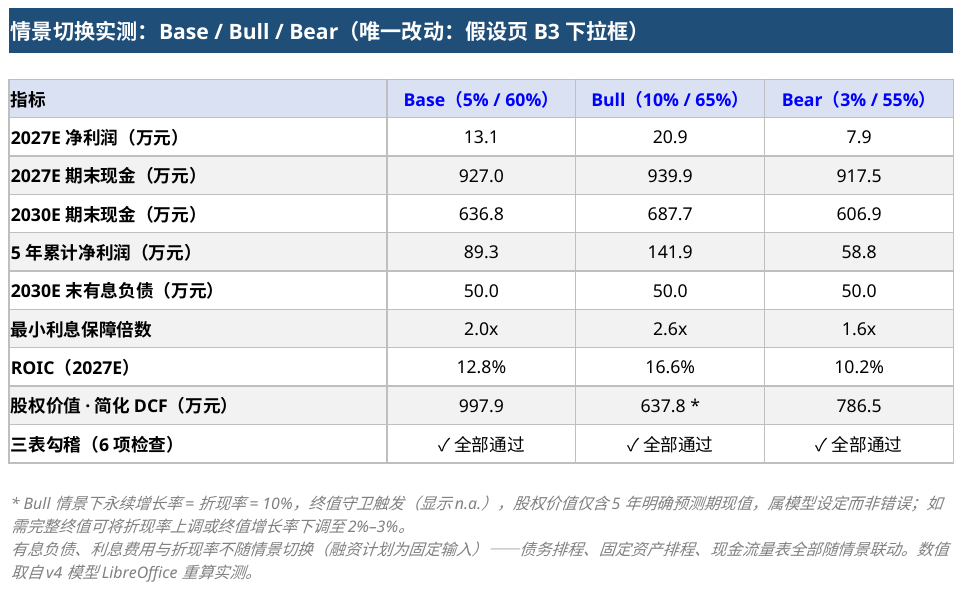

# Excel 三表联动模型 v4 — 星链数科（模拟 fintech）

## 证明什么技能

**Excel 高阶 + 财务建模（机构口径）**：情景切换器（模型主控台，Base/Bull/Bear 下拉 + INDEX/MATCH 驱动因子映射）、**债务排程与利息引擎**（平均余额 × 利率，新增借款当年生息，全额付现，无循环引用）、**固定资产排程**（折旧按净值计提、以期初净值为上限，不会折成负值）、**三情景并排对比表**（第六节，公式驱动，无需逐个切换）、**ROIC 投入资本回报**、数据验证（下拉列表 + 数值区间）、三表联动（利润表 → 现金流量表 → 资产负债表 + 支持排程）、勾稽校验（资产 = 负债 + 权益 + **6 项自动检查**）、解析解敏感性分析（3 张表，实时勾稽）、简化 DCF 估值（无杠杆自由现金流口径）、现金跑道图（安全线预警）、组合图表（柱 + 次坐标轴折线）。

模型文件：`three_statement_model.xlsx`，共 **533 个公式、0 个公式错误、无循环引用**，所有预测单元格均为公式驱动、无假设硬编码。

v4 = v3 全部功能 + **MVP1 优化清单**：说明页「30 秒速览」、模型地图、敏感性第六节三情景并排对比、ROIC、五处口径注释补全、现金流量表行名改为"营运资本变动（增加 = 现金占用）"。

## 工作表结构（按面试演示动线排序）

```
说明与检查 → 假设 → 利润表 → 资产负债表 → 现金流量表 → 支持排程 → 图表 → 敏感性分析
```

| Sheet | 内容 |
|---|---|
| 说明与检查 | **【30 秒速览】**（是什么 / 怎么演示 / 核心数字三行）+ **核心结论看板**（10 项动态大字指标）+ 现金安全预警 + 演示动线 + **模型地图**（Sheet 关系文字版）+ **6 项自动勾稽检查** + 口径声明 |
| 假设 | **① 情景切换器**（Base/Bull/Bear 下拉）+ 12 个假设（全部数据验证）+ 驱动因子映射表（第 26–28 行） |
| 利润表 / 资产负债表 / 现金流量表 | 三表联动主体；利润表含 EBIT / 利息费用 / 税前利润；资产负债表含**有息负债**行；现金流量表按"利息全额付现"口径列示，营运资本行名为"营运资本变动（增加 = 现金占用）" |
| **支持排程** | **债务排程**（期初 + 新增 − 偿还 = 期末；利息 = 平均余额 × 利率）+ 偿债能力与回报指标（资产负债率 / 有息负债权益比 / 利息保障倍数 / **ROIC**）+ **固定资产排程**（原值 / 资本支出 / 净值 / 累计折旧滚动） |
| 图表 | 图1 收入与净利润｜图2 经营现金流与期末现金｜图3 现金跑道（期末现金 vs 安全线）｜**图4 有息负债余额与利息费用** |
| 敏感性分析 | 简化 DCF 估值 + 3 张敏感性表（5 年累计净利润 / 2030E 期末现金 / 利率 × 融资规模 → 累计利息，均实时勾稽）+ 边际敏感度 + **第六节 三情景并排对比表** + 动态结论句 |

## 如何打开（演示 3 步走）

1. 打开 **「说明与检查」**：看顶部【30 秒速览】→"核心结论看板"→下方"自动勾稽检查"6 项全部 ✓；
2. 打开 **「假设」**，把顶部**情景切换下拉框从 Base 切到 Bull**（增长率 5%→10%、毛利率 60%→65%），口头说："我只改了这一个下拉框"；
3. 依次切到三张报表（同步重算）→「支持排程」（债务/固定资产滚动 + ROIC）→「图表」（四张图重绘）→「敏感性分析」第六节（三情景并排对比表与动态结论句自动改写）。

加分演示：打开 **「支持排程」**，修改蓝色"新增借款 / 偿还本金"——利息费用、资产负债率、利息保障倍数、筹资现金流、期末现金全部联动（利息 = 平均余额 × 利率，无循环引用）。

自定义情景：改「假设」页第 26–28 行**驱动因子映射表**的蓝色单元格（增长率为下拉，可直接换值）。

## 模型地图（Sheet 数据流）

```
【假设】——情景切换 + 蓝色输入，全簿唯一数据入口
   ├─→【利润表】收入/成本/利息/净利润
   ├─→【资产负债表】资产 = 负债 + 权益（逐年勾稽）
   └─→【现金流量表】经营 + 投资 + 融资 = 净现金流
【支持排程】债务滚动 + 固定资产滚动
   ├─→ 利息费用 →【利润表】
   ├─→ 有息负债、固定资产净值 →【资产负债表】
   └─→ 偿付利息、新增借款 →【现金流量表】
【图表】← 读取 四表（4 张图随情景重绘）
【敏感性分析】← 读取 全簿（3 张敏感性表 + 第六节三情景并排对比 + 动态结论）
【说明与检查】（本页）← 汇总 全簿（速览 + 看板 + 模型地图 + 6 项勾稽）

数据流单向；唯一天然回路"利息 ⇄ 现金"由平均余额法显式解开，全簿无循环引用。
```

## 一句话结论

**切一个下拉框，三张报表 + 债务排程 + 四张图 + 敏感性分析全部联动**——这就是 FP&A 的"模型主控台"设计；而利息引擎的纳入，让模型从"经营模拟"升级为"含资本结构的完整三表联动"；第六节三情景并排对比与 ROIC 的加入，则让"一个动作看全貌、一个指标看资本回报"成为默认体验。



## 模型逻辑

```
情景切换器（Base/Bull/Bear）
   → 驱动因子映射表（INDEX+MATCH 抓取对应情景的增长率/毛利率）
   → 利润表：收入 = 上年收入 ×（1+增长率）
              EBIT = 毛利 − 运营成本 − 折旧
              利息费用 = 支持排程！平均有息负债 × 年利率（A-11）
              净利润 =（EBIT − 利息费用）×（1 − 税率）
   → 支持排程：期末有息负债 = 期初 + 新增借款 − 偿还本金
                固定资产：期末净值 = 期初净值 + 资本支出 − 折旧（MIN(期初净值×折旧率, 期初净值)）
                ROIC = EBIT ×（1 − 税率）÷（有息负债 + 总权益 − 现金）
   → 现金流量表：经营 = 净利润 + 折旧 + 利息费用 − 营运资本变动（增加 = 现金占用）
                投资 = −资本支出
                融资 = 新增借款 − 偿还本金 − 偿付利息
   → 资产负债表：现金 = 上年现金 + 净现金流；有息负债 = 债务排程期末余额
                 留存收益 = 上年留存 + 净利润
   → 勾稽校验：总资产 −（总负债 + 总权益）= 0，各年显示"平衡"
```

**利息引擎的会计口径**（中国企业会计准则，间接法）：

- 利息 = 平均有息负债 × 年利率——新增借款自放入年起即按平均余额生息（2025A 年内新增的 200 万即产生 4.5 万利息），平均余额法下当年新增借款按半年计息（偏乐观，如需更保守可改期末余额法）；
- 利息当年全额付现：经营活动"加：利息费用"与筹资活动"偿付利息支付的现金"对消，净利润 =（EBIT − 利息）×（1 − 税率），税盾自然体现；
- 负债余额只取决于融资计划输入，不取决于现金 → **不存在"利息 ← 负债 ← 现金"循环引用**，测算结果稳定可复现。

## 关键结果

**基准情景 Base（增长率 5%、毛利率 60%、利率 4.5%）**

| 指标 | 2025A | 2026E | 2027E | 2028E | 2029E | 2030E |
|---|---|---|---|---|---|---|
| 利息费用（元） | 45,000 | 123,750 | 168,750 | 168,750 | 123,750 | 56,250 |
| 净利润（元） | 191,250 | 149,063 | 130,969 | 147,417 | 198,447 | 267,224 |
| 期末有息负债（元） | 2,000,000 | 3,500,000 | 4,000,000 | 3,500,000 | 2,000,000 | 500,000 |
| 利息保障倍数 | 6.7x | 2.6x | 2.0x | 2.2x | 3.1x | 7.3x |
| ROIC | 11.3% | 12.1% | 12.8% | 13.6% | 14.4% | 15.3% |
| 期末现金（元） | 7,000,000 | 8,644,062 | 9,270,031 | 8,912,436 | 7,605,845 | 6,367,995 |
| 勾稽校验 | ✓ 平衡 | ✓ 平衡 | ✓ 平衡 | ✓ 平衡 | ✓ 平衡 | ✓ 平衡 |

其他输出：5 年累计净利润 89.3 万；**增长率每 +1pp → 5 年累计净利润 +5.2 万**（边际敏感度，当前增长率附近的局部近似）；5 年累计利息 64.1 万；简化 DCF 股权价值 997.9 万（企业价值 497.9 万 + 基年净现金 500 万 = 现金 700 万 − 有息负债 200 万）。

**三情景并排对比（v4 新增 · 敏感性分析第六节，公式驱动）**

| 指标 | Base（5% / 60%） | Bull（10% / 65%） | Bear（3% / 55%） |
|---|---|---|---|
| 2027E 净利润（万元） | 13.1 | 20.9 | 7.9 |
| 2027E 期末现金（万元） | 927.0 | 939.9 | 917.5 |
| 2030E 期末现金（万元） | 636.8 | 687.7 | 606.9 |
| 5 年累计净利润（万元） | 89.3 | 141.9 | 58.8 |
| 2030E 末有息负债（万元） | 50.0 | 50.0 | 50.0 |
| 最小利息保障倍数 | 2.0x | 2.6x | 1.6x |
| ROIC（2027E） | 12.8% | 16.6% | 10.2% |
| 股权价值 · 简化 DCF（万元） | 997.9 | 637.8 * | 786.5 |
| 三表勾稽（6 项检查） | ✓ 全部通过 | ✓ 全部通过 | ✓ 全部通过 |

> \* Bull 情景下永续增长率 = 折现率 = 10%，终值守卫触发（显示 n.a.），股权价值仅含 5 年明确预测期现值——这正是估值守卫单元格的设计目的。第六节当前情景列与模型实时勾稽校验（✓），切换情景后自动跟随。

## 现金跑道图（图3）

期末现金折线 vs 红色安全线（「假设」页 A-10，默认 400 万元）：看板自动输出"预测期内现金始终高于安全线，最低 636.8 万元，安全垫 236.8 万元"；若把偿还本金调高或毛利率调低，预警自动翻转为"⚠ 现金低于安全线"。演示话术："利润是观点，现金是事实——按当前假设现金安全，但加大偿债或资本开支就会跌破安全线，需要提前规划融资。"

## 质量审计（交付前已通过，47 项检查）

- **公式错误**：533 个公式全部重算，0 个 #REF!/#DIV/0!/#VALUE!/#NAME? 错误，**无循环引用**；
- **勾稽完整性**：资产=负债+权益、现金勾稽、净利润联动、留存收益滚动、有息负债联动、利息联动、债务滚动、利息=平均余额×利率、融资现金流三项、折旧≤期初净值、固定资产滚动、折旧 CF=IS、利息保障倍数>1、负债余额非负、现金高于安全线、**ROIC 口径复算**，**16 项全部通过**；
- **硬编码审计**：公式中仅有结构性常量（期间序号 1–5、期间数 6、容差 0.01、除零守卫 0.001、万元换算 10000、年份权重 0.5–4.5），**所有假设值集中在「假设」页**；
- **情景联动测试**：Base/Bull/Bear 三情景下，三表 + 支持排程 + 图表 + 第六节对比表全部联动，6 项勾稽始终保持通过，且第六节当前情景列与模型逐值一致；
- **第六节勾稽**：Base 列 2027E 净利润 = 利润表 D13、2030E 现金 = 资产负债表 G5、股权价值 = DCF C15，三项均 ✓；
- **数据验证**：17 条（假设面板区间验证 + 情景区间 + 融资计划区间 + 敏感性行列头 + 第六节列头下拉）；
- **颜色规范**：蓝色 = 可修改输入，黑色 = 本表公式，绿色 = 跨表引用，浅蓝底 = 情景驱动/校验区。

## 口径说明（对应常见面试追问）

- **折旧**：按固定资产**期初净值 × 折旧率（A-12，默认 5%）**计提，并以期初净值为上限（MIN），期末净值永远为正、不会"折到零"；原值 / 净值 / 累计折旧完整滚动，见「支持排程」页第三节。
- **利息**：**平均有息负债 × 年利率（A-11）**。新增借款自放入年起按平均余额生息（平均余额法偏乐观，可改期末余额法更保守）；利息全额付现，经营活动加回、筹资活动列示偿付利息，两者对消；净利润已含税盾。由于负债余额只由融资计划决定，模型**无循环引用**（不需要迭代计算开关）。
- **营运资本**：现金流量表行名"营运资本变动（增加 = 现金占用）"——正数表示现金被占用，间接法中为减项；= Δ应收 − Δ应付。
- **ROIC**：EBIT ×（1 − 税率）÷（有息负债 + 总权益 − 现金），见「支持排程」页；衡量投入资本回报，不受杠杆结构影响，比 ROE 更适合跨资本结构比较；与 DCF 互为补充——DCF 回答"公司值多少钱"，ROIC 回答"每一块投入资本赚回多少"。
- **估值**：简化 DCF 采用无杠杆自由现金流（经营 + 投资 − 利息税盾），永续增长终值假设 = 当前收入增长率（Base 5%；对成熟期公司建议下调至 2%–3%，本模型为简化处理），带"折现率≤增长率"守卫；股权价值 = 企业价值 + 基年现金 − 有息负债。
- **敏感性简化假设**（敏感性①）：解析解假设 CapEx 与融资计划不随增长率变化（折旧、利息取当期固定计划）、ARPU 稳定（客户数增速 = 收入增速）；若高增长需要额外 CapEx / 融资，实际利润增幅会低于本表。

## 数据来源

模拟 fintech 公司 **"星链数科"** 的技能演示模型，基年（2025A）数据为**模拟实际数**（非真实财报），参考 P4 月度经营分析包口径整理。仅供学习与技能展示，不构成任何投资建议。

## 面试官可能追问（8 问速答）

1. **三表联动的第一张表是哪张？** 从利润表出发（收入/成本驱动净利润），利润表与支持排程喂给现金流量表，现金流量表的期末现金与融资活动再回资产负债表；资产负债表的"平衡"是结果校验，不是输入。
2. **为什么没有循环引用？** 利息取决于负债余额，负债余额只由融资计划（蓝色输入）决定、不取决于现金；模型不需要打开"迭代计算"开关也能稳定重算——这是显式解开"利息⇄现金"回路的做法。
3. **折旧为什么用期初净值？** 避免"净值越低折旧越少、永远折不完"或折成负值；MIN(期初净值×折旧率, 期初净值) 保证期末净值永远为正。
4. **ROIC 和 ROE 的区别？** ROE 受杠杆放大；ROIC = EBIT×(1−t)÷（有息负债+权益−现金）剔除杠杆与现金影响，衡量经营本身的资本回报，跨资本结构可比。
5. **终值为什么用 5% 永续增长？** 简化处理，等于当前收入增长率；成熟期公司应下调至 2%–3%（注释已声明），且模型带"折现率≤增长率"守卫，Bull 情景下会显示 n.a. 而不是算出荒谬的终值。
6. **敏感性表的数为什么能和模型勾稽？** 表内是解析解（闭式公式），不是另算一套；切换情景后 Base 列与模型逐值校验 ✓，其余情景列同步重算。
7. **利息保障倍数低的年份怎么办？** 看板上限是 400 万安全线 + 最小利息保障倍数 2.0x；若把偿还计划提前或利率上调，指标同步恶化——这正是排程要回答的"融资计划是否可持续"。
8. **这个模型怎么落地到真实工作？** 换数即用：把「假设」页蓝色单元格替换为真实预算数（收入增长率、毛利率、CAC、税率、折现率、融资计划），勾稽检查保持全 ✓ 即可信任输出。

## 面试话术

> "这是一个带情景切换器、含债务排程与利息引擎的 fintech 三表联动模型。打开第一页的『30 秒速览』就能看到核心数字：当前 Base 情景下 2027E 净利润 13.1 万、2030E 期末现金 636.8 万、股权价值 997.9 万、最小利息保障 2.0x，6 项自动勾稽检查全部通过。
>
> 演示时我只做一个动作：把「假设」页顶部的情景下拉框从 Base 切到 Bull——增长率从 5% 变 10%、毛利率从 60% 变 65%，三张报表、支持排程、四张图、敏感性分析和底部动态结论句全部自动重算。情景切换的原理是 INDEX+MATCH 从驱动因子映射表里抓取对应情景的假设值，这就是 FP&A 说的'模型主控台'。如果想一次看全三个情景，「敏感性分析」第六节有三情景并排对比表，不用逐个切换。
>
> 这个版本我补上了利息引擎：「支持排程」页做债务滚动，利息 = 平均有息负债 × 利率，新增借款当年就生息；利息在现金流量表里'经营加回、筹资付现'对消，净利润已经体现税盾，所以不存在循环引用，不需要迭代计算。折旧也改成了按期初净值计提、以净值为上限，永远不会折成负值。资产负债表的有息负债、偿债能力指标全部和债务排程联动。回报侧我加了 ROIC——EBIT×（1−税率）除以投入资本，不受杠杆影响，和 DCF 合看才是完整的资本配置视角。"

## 目录结构

```
skills-proof/01-excel-three-statement/
├── three_statement_model.xlsx    # 三表联动模型 v4（主交付物，533 公式 0 错误）
├── README.md                     # 本说明
├── scripts/
│   └── build_model.py            # 模型生成脚本（openpyxl 单文件，可完整复现交付物）
├── images/                       # 9 张截图
│   ├── 01_dashboard_checks.png        # 说明与检查（30秒速览 + 结论看板 + 现金预警 + 模型地图 + 6 项勾稽）
│   ├── 02_assumptions_panel.png       # 假设页（情景切换器 + 12 项假设 + 驱动因子映射表）
│   ├── 03_income_statement.png        # 利润表（EBIT / 利息费用 / 税前利润 / 净利润）
│   ├── 04_balance_sheet.png           # 资产负债表（含"有息负债"行，勾稽"平衡"）
│   ├── 05_cash_flow.png               # 现金流量表（利息加回 + 筹资活动三项 + 营运资本变动行 + 安全线）
│   ├── 06_debt_dep_schedule.png       # 支持排程（债务排程 + 偿债/ROIC 指标 + 固定资产排程）
│   ├── 07_charts.png                  # 图表页（4 张图，含现金跑道与债务/利息）
│   ├── 08_sensitivity.png             # 估值 + 3 张敏感性 + 边际敏感度 + 第六节三情景并排对比 + 动态结论
│   └── 09_before_after_scenario.png   # 三情景对比实测表（Base / Bull / Bear）
├── .gitignore                    # Office 临时文件 / 锁文件 / 系统垃圾文件
└── .gitattributes                # 二进制（xlsx/png）与行尾规范
```

## 复现方式

模型由 `scripts/build_model.py` 单文件生成（仅依赖 openpyxl）：

```bash
python3 scripts/build_model.py 0.05 three_statement_model.xlsx
```

- 脚本产出**公式版**工作簿（`fullCalcOnLoad=True`），用 Excel / WPS / LibreOffice 打开即自动重算，无需手动开启迭代计算；
- 交付的 `three_statement_model.xlsx` 已由 LibreOffice headless 重算并写入缓存值，程序化读取（如 openpyxl `data_only=True`）也能直接得到数值；
- 已通过公式级 diff 验证：脚本重新生成的工作簿与交付物**全部单元格公式完全一致**。
