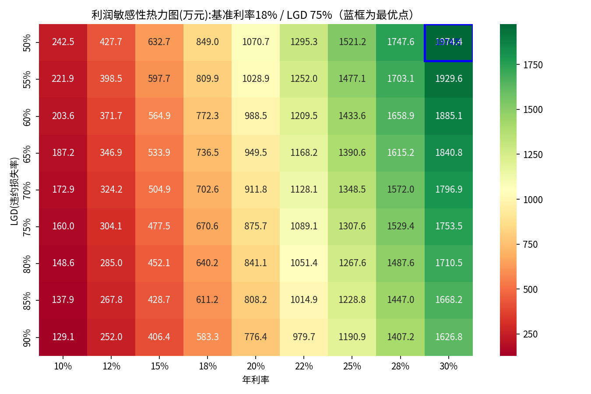

# Python 财务建模：风险定价利润曲线与敏感性分析

[](https://colab.research.google.com/github/Zlz027/fintech-ba-portfolio/blob/main/skills-proof/05-python-finance/financial_model.ipynb)

## 证明什么技能

用 Python（pandas / numpy / matplotlib / seaborn）实现财务建模：批量计算不同审批阈值下的**通过率、坏账率、利润**，定位利润最大化点，并生成**利率 × LGD 二维敏感性热力图**——一次运行完成 4,050 种情景组合（81 种利率×LGD 组合 × 50 个审批阈值），全程秒级。

## 如何运行

- **在线（推荐）**：点击上方 Colab 徽章，`代码执行程序 → 全部运行`，无需安装任何环境（数据由 numpy 模拟生成，不依赖本地文件）。
- **本地运行**：`pip install -r requirements.txt`，然后打开 `financial_model.ipynb` 全部执行。

## 一句话结论

在 LGD=75%、利率=18% 的基准假设下，最优审批阈值为 0.160，对应通过率 87.0%、坏账率 7.3%、预期利润约 711 万元；Python 的优势是**批量做敏感性分析**——当别人还在 Excel 里手动改参数时，这里已经跑完 4,000 多种情景。

## 业务背景

模拟一个消费信贷客群（10,000 名客户，PD 服从 Beta(2,20) 分布，均值约 9%），在给定利率、LGD、资金成本下，扫描不同审批阈值，找到利润最大化的通过率/坏账率组合。

与 P1 的区别与联动：P1 用真实 GMSC 数据 + 评分卡，结论是"风险定价 vs 统一定价年化增量利润 ¥1,663 万"；本 MVP 用模拟数据 + Python 验证利润曲线的逻辑，证明"改利率/LGD → 秒级重算"，与 P1 的评分卡 + 真实数据形成互补。

## 模型逻辑

1. **生成模拟客群**：10,000 名客户的 PD（违约概率）服从 Beta(2, 20) 分布（均值约 9%），代表风险分层的小微信贷客群。
2. **核心函数** `calculate_profit_at_cutoff`：给定审批阈值 cutoff，计算通过率、通过客群平均 PD（≈预期坏账率）与利润；
   利润口径 = 获批户数 × EAD × [ (1−PD) × 利率 − PD × LGD − 资金成本 ]（利息仅由未违约者产生，违约者本金按 LGD 损失）。
3. **批量扫描**：遍历 50 个审批阈值（0.01~0.50），绘制双轴图（左轴：通过率/坏账率折线；右轴：利润柱状），标出利润最大化点。
4. **二维敏感性**：利率（10%~30%）× LGD（50%~90%）9×9 网格，每格重扫 50 个阈值取最优利润，绘制热力图。

## 核心假设（改这三个数，全表自动重算）

| 假设参数 | 默认值 | 业务含义 |
|---|---|---|
| `INTEREST_RATE` | 18% | 贷款年利率（风险定价的核心抓手） |
| `LGD` | 75% | 违约损失率（Loss Given Default） |
| `FUNDING_RATE` | 3% | 资金成本率 |

## 输出示例（动态结论，随假设自动更新）

```text
【结论】基准假设下最优审批阈值为 0.160:通过率 87.0%、坏账率 7.3%、预期利润 7,108,855 元。
【敏感性】当 LGD=50%、利率=30% 时,利润最大化为 1,974 万元。
【效率】敏感性分析覆盖 81 种利率×LGD 组合，每种组合扫描 50 个审批阈值，共 4,050 次情景计算，
Python 秒级完成——如果手动在 Excel 里改参数，假设每次改参数+记录结果需要 30 秒，
4,050 次需要约 34 小时；Python 只需 1 秒。
【对比】如果市场竞争导致利率从 18% 降到 12%，最优阈值下的最大利润将从 711 万降至 272 万，降幅 61.7%。
【业务含义】这意味着风险定价能力是利润的核心杠杆：在竞争激烈的市场，
能否对低风险客户降价、对高风险客户提价，直接决定利润空间。
【决策建议】业务方可直接采用：审批阈值 0.16（通过率 87.0%、坏账率 7.3%、年化利润 711 万元）。
  · 保守方案 阈值0.10: 通过率 63.5%, 坏账率 5.4%, 利润 633 万
  · 激进方案 阈值0.20: 通过率 94.2%, 坏账率 8.1%, 利润 700 万
【PD敏感性】Beta(1,9) 均值 10.0%，最优阈值下最大利润 726 万
【PD敏感性】Beta(2,20) 均值 9.1%，最优阈值下最大利润 711 万
【PD敏感性】Beta(5,45) 均值 10.0%，最优阈值下最大利润 594 万
```

## 目录结构

```text
skills-proof/05-python-finance/
├── financial_model.ipynb        # 主交付物（84 行代码，含执行输出）
├── requirements.txt             # 运行依赖
├── README.md                    # 本文件
└── images/
    ├── profit_curve.png         # 双轴利润曲线图
    └── sensitivity_heatmap.png  # 利率 × LGD 利润敏感性热力图
```

> 注：`images/` 下的两张图是 Notebook 运行时自动生成的（`os.makedirs('images', exist_ok=True)` + `plt.savefig`），无需手动创建。



## 局限性与声明

**本模型的边界：**

- **PD 分布为模拟**：Beta(2,20) 是假设分布，均值约 9%，用于演示利润曲线逻辑。真实场景 PD 应由历史违约数据拟合（如逻辑回归评分卡、XGBoost 等），并经过 KS/AUC/Gini 验证。
- **EAD 固定 ¥10,000**：简化假设。真实场景应按客户额度分层（如 5k/10k/20k），或按产品差异化（消费贷 vs 经营贷）。
- **未含运营成本**：仅含资金成本和信用损失。真实场景应加入获客成本（CAC）、客服成本、系统成本、合规成本，才能得到完整的 unit economics。
- **未含风险定价**：利率固定 18%，未随 PD 浮动。真实场景应对低风险客户降价、高风险客户提价，这正是 P1 项目"风险定价 vs 统一定价"的核心议题。
- **未含时间维度**：单期模型，未考虑放款节奏、还款节奏、提前还款、逾期迁徙。真实场景应用月度 cohort 或 roll rate 模型。

**生产环境的正确做法：**

1. 用历史违约数据拟合 PD 模型（评分卡 + XGBoost challenger）；
2. 按额度分层做差异化 EAD；
3. 加入运营成本率（如 3%-5%）；
4. 实现风险定价（利率 = 盈亏平衡利率 + 目标利润率）；
5. 按月监控 PSI，偏离超过 0.25 触发重训。

**声明：** 本模型为演示用，证明"批量敏感性分析"能力，不构成投资建议。全部数字需具备资质的专业人士复核签署后方可使用。

## 面试话术

> "这个 notebook 用 Python 复现了我在 P1 信用风险项目里的利润曲线逻辑。您可以看到，我改动顶部假设里的 LGD 或利率，热力图和最优阈值会自动重算——利率从 18% 降到 12%，最大利润直接从 711 万掉到 272 万。相比 Excel，Python 能在一秒内跑完 4,000 多种假设组合，通过率、坏账率、利润的权衡一目了然，这是 FP&A 做情景分析和风险定价的高效工具。"
